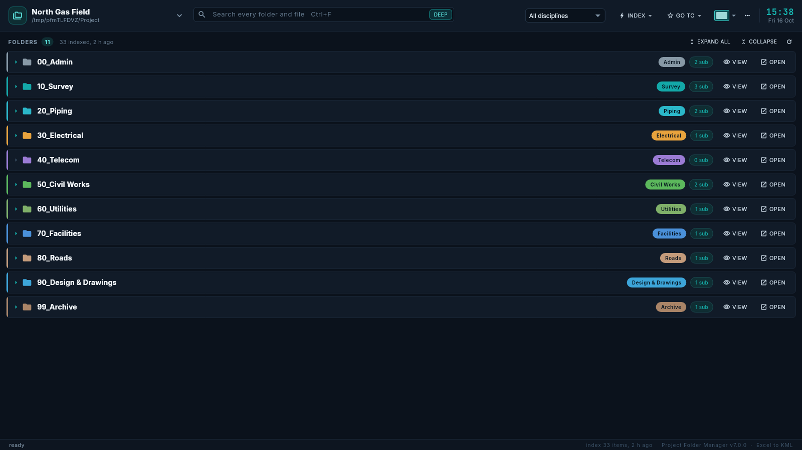
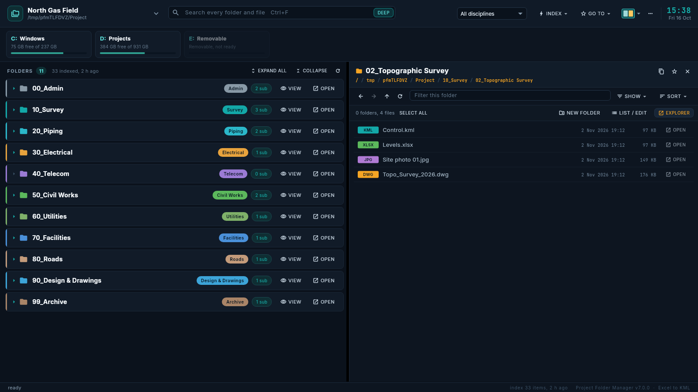
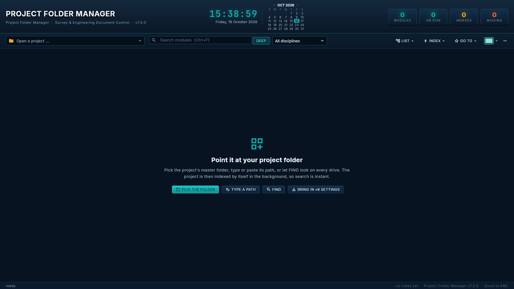

# Project Folder Manager

A Windows dashboard for your project folders, by [Excel to KML](https://www.exceltokml.com/project-folder-manager):
open a drive or any folder and see the folders in it with their discipline colours (00 Admin …
99 Archive), search every folder and file instantly, and view, copy, move, rename and tidy them in
a side panel without leaving the dashboard.

Version 7 is the 6.2 HTML application rebuilt in Flutter as a proper installed program that updates
itself, with a cleaner look. See [CHANGELOG.md](CHANGELOG.md) for what is new.




## Install
Download `ProjectFolderManager-Setup.exe` from the [latest release](https://github.com/Asjad-Mehmood/Project-manager/releases/latest)
and open it. It installs for your Windows user only (no administrator rights), to
`%LOCALAPPDATA%\ProjectFolderManager`, with Start menu and desktop shortcuts. Uninstall from
Settings → Apps. Windows 10 or 11, 64-bit.

The first time it opens it asks what to open: click a drive, or choose any folder (a project's
master folder works best). Change it any time from the top left. If a 6.2 copy's settings are on
the PC, the start page offers to bring them in.



## Use
The folder list is read from the disk, so it is never out of step: folders made, renamed or deleted
in Explorer show up by themselves. There is nothing to scan or rebuild.

| | |
|---|---|
| **Folder ▾** (top left) | The open folder's name and path. Click to open a drive, choose a folder, type or paste a path, find projects on your drives, or go back to a recent one. This folder: open it in Explorer, rename it here (only the name shown), remove it from the list. |
| **Search, DEEP, Discipline** | Without DEEP the box filters the folder names; with DEEP it searches every indexed folder and file (every word must be in the name). Esc clears it. |
| **INDEX ▾** | Index this folder, the whole drive or all drives; Stop keeps what was found. The open folder also indexes itself in the background. |
| **GO TO ▾** | Pinned folders (right-click any folder → Pin) and every drive, in the panel. |
| **View ▾** | The six layouts (Alt+1 to Alt+6) and the drives strip. |
| **MANUAL** (F1) | How to use every part of the program, topic by topic. |
| **⋯** | Bring in 6.2 settings, look for an update, keyboard shortcuts, about. |
| **The clock** | Click it for the calendar. |
| **Above the list** | How many folders, the index, EXPAND ALL, COLLAPSE and refresh (F5). |
| **Folders** | Click a name or VIEW for the panel, OPEN or double-click for Explorer, the arrow for its sub-folders, the coloured chip for its discipline. Right-click for more. |
| **Panel** | Back, forward, up, filter, Show ▾ and Sort ▾ on top. Below, what you can do now: New folder, LIST / EDIT and Explorer; or, once something is selected, Copy, Cut, Rename and Delete. Paste appears when something is copied. Drag items onto any folder. UNDO (Ctrl+Z). |
| **LIST / EDIT** | The names in a box to copy, or to edit and rename many at once, with a preview and quick tools (find and replace, add text, number, case). |

Settings live in `%APPDATA%\Excel to KML\Project Folder Manager\settings.json`, the index in
`%LOCALAPPDATA%\Excel to KML\Project Folder Manager\index`.

## Releases
A release is made by pushing a tag, never by hand:

1. Write `docs/releases/v7.0.1.md` (the release's description) and add a line to `CHANGELOG.md`.
   Without it the release still goes out, with a short description pointing to the changelog.
2. Merge to `main`, then tag: `git tag v7.0.1 && git push origin v7.0.1` (or publish a release
   with a new tag on GitHub).
3. [`release.yml`](.github/workflows/release.yml) runs the tests, builds the program and the
   installer on Windows, installs and checks that very installer (`tool/windows_check.ps1`),
   writes `latest.json` (version and SHA-256) and publishes both files as the latest release; a
   last job downloads them the way installed copies do and checks the SHA-256.

Installed copies read `latest.json` from the latest release a few seconds after opening; when the
version is higher they offer the update, download the installer, check its SHA-256 and run it
silently, and the new version opens by itself.

## Develop
Flutter 3.47.7. `flutter test` runs everything that doesn't need Windows; [`check.yml`](.github/workflows/check.yml)
also builds, installs, self-checks (`ProjectFolderManager.exe --self-check <folder> <report.json>`
does the real jobs on a real Windows), opens and uninstalls the program on every push, and keeps
the test installer and screenshots under the run's Artifacts.

```
flutter pub get
dart format lib test            # page width 120
flutter analyze
flutter test
flutter test test/ui_test.dart --dart-define=SHOTS=true   # pictures in docs/screenshots
```

| | |
|---|---|
| `lib/src/core` | The rules, without Flutter: settings and the 6.2 file, disciplines, the index and its background walk, copy / move / rename / undo, LIST / EDIT, FIND |
| `lib/src/state` | `AppModel` (everything the window shows and does) and `Store` (files in AppData) |
| `lib/src/platform` | Windows: drives, Recycle Bin, opening files and folders (win32), folder picker |
| `lib/src/ui` | The window (`theme.dart` holds the colours) |
| `lib/src/update` | Self-update |
| `installer`, `tool`, `.github/workflows` | NSIS installer, the Windows check, CI and releases |

Copyright © 2026 Asjad Mehmood.
